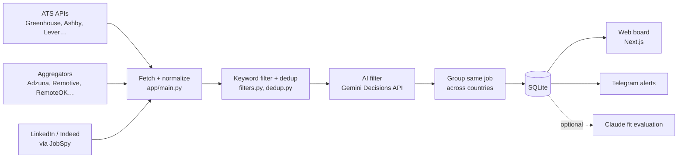

# AI-Powered Job Search Automation

[](https://github.com/ThisIsItz/job_search_tool/actions/workflows/ci.yml)

A personal pipeline that finds the jobs worth applying to so I don't have
to scroll job boards: it pulls postings from company ATS APIs, job
aggregators and LinkedIn/Indeed, screens them with a cheap keyword filter
and then an LLM, and sends the good ones to my phone twice a day — with a
local web board to review and track applications.

In a typical batch, **~3,000 fetched postings → ~1,100 after dedup and the
keyword filter → ~110 the AI filter keeps**, ranked by how well they match my
stack.


## Features

- **Many sources, one pipeline** — Greenhouse, Ashby, Lever, Workable and
  SmartRecruiters APIs; Adzuna, Remotive, RemoteOK, Jobicy, We Work
  Remotely; LinkedIn and Indeed via [JobSpy](https://github.com/speedyapply/JobSpy).
  Each source is normalized to one job shape, including annual salary.
- **Two-stage filtering** — a free keyword filter drops the obvious misses,
  then an LLM (Gemini Decisions API) reads each remaining posting and
  answers closed questions: remote vs hybrid vs on-site, can I actually be
  hired from where I live, role type, seniority, stack fit (0–4), required
  languages.
- **Same job, many countries** — postings repeated per country (one
  employer posted the same opening in 46) are grouped into one.
- **Telegram alerts** — one message per new match, best fit first, with
  buttons to open the posting or apply; capped per run so it never floods.
- **Review board** — Next.js app over the same SQLite database: sort by
  stack fit or salary, filter, track `applied / interview / rejected` and
  notes.
- **Optional deep evaluation** — Claude scores fit 0–100 against a
  competency-based profile and lists concrete gaps and strengths.
- **Runs itself** — scheduled twice a day with launchd; failures are
  reported to Telegram.

## How it works



## Design decisions

- **Cheap filter first, LLM second.** The keyword filter only drops what's
  certain (non-technical titles, stale postings) and costs nothing; the LLM
  then reads only what survives. An earlier, stricter keyword filter
  dropped good jobs whose wording it didn't know ("Remoto", "Spain",
  "Junior UX/UI Designer", "SDE II"), so location, stack and role type moved
  to the LLM, which reads the whole posting.
- **Probabilities, not prose.** The Decisions API returns calibrated
  probabilities and a confidence per question, so rejection rules are plain
  thresholds in code — and an unsure answer (e.g. a thin description that
  never mentions work mode) keeps the job instead of dropping it.
- **"Remote" isn't enough.** Most rejections are remote roles restricted to
  one country (US-only, Canada-only…), which only shows up in the text — the
  case keyword matching can't catch.
- **Group after screening, not before.** The same posting in different
  countries can have different eligibility, so each version is screened on
  its own and only the passing ones are grouped, by company, title and ≥80%
  similar description. A different description stays separate: a
  duplicate may show twice, but a distinct job is never hidden.
- **Untrusted input.** Job text is third-party content that can try to
  steer an LLM ("ignore your instructions…"), so it's wrapped and marked
  as data in every prompt.
- **Resilient scheduled runs.** Per-job commits (a crash keeps finished
  work), retries on dropped connections, waiting for Wi-Fi after the Mac
  wakes, and a Telegram notice when a run fails.
- **Privacy by default.** Personal config (profile, target companies,
  searches, API keys) is gitignored, with examples committed; only the
  posting plus the needed preferences are sent to each API; the web board
  only listens on localhost; the bot token is scrubbed from error messages.

**Stack:** Python 3.14 (httpx, pandas via JobSpy, google-genai, anthropic),
SQLite, Next.js 16 + TypeScript, Telegram Bot API, launchd, pytest, GitHub
Actions.

## Setup

```bash
pip install -r requirements.txt
cp .env.example .env
# fill in .env with the keys you need — see the comments in that file
```

Create your own config from the templates (these files are gitignored —
they hold your personal experience and search preferences):

```bash
cp profile.example.yaml profile.yaml
cp companies.example.yaml companies.yaml
cp aggregators.example.yaml aggregators.yaml
# then edit them with your own background, targets and searches
```

`profile.example.yaml` is a blank template — it tells you the shape but
not the bar. For a fully worked (fictional) example showing the level of
specificity/quantification each evidence bullet should actually have, see
[`profile.sample.yaml`](profile.sample.yaml).

`GEMINI_API_KEY` (free at [aistudio.google.com](https://aistudio.google.com))
is needed for the AI filter, `ANTHROPIC_API_KEY` only for the optional
Claude evaluation. Adzuna (`ADZUNA_APP_ID`/`ADZUNA_APP_KEY`) is only needed
if you keep an Adzuna entry in `aggregators.yaml` — register a free key at
[developer.adzuna.com](https://developer.adzuna.com). Remotive needs no auth
but only covers remote roles. JobSpy (LinkedIn/Indeed) needs no auth either
— it scrapes the sites' public, logged-out job search.

### Customize for your own search

**Before your first run, check these:**

1. **`profile.yaml` → `core_stack`** — the technologies the AI filter
   scores stack fit against.
2. **`profile.yaml` → `ai_filter`** — where you can be hired, an optional
   relocation city, the languages you speak, and which role
   types/seniorities you accept (see `profile.example.yaml`).
3. **`companies.yaml`** — the company registry: add/remove companies to
   match who you're actually applying to (see the file's header comment for
   the format).
4. **`aggregators.yaml`** — the keyword/location searches: update them to
   what and where you're looking.

## Usage

### 1. Fetch + filter (free)

```bash
python -m app.main                    # all companies + aggregators
python -m app.main --company gitlab   # just one company, for debugging a fetcher
python -m app.main --skip-aggregators # companies.yaml only
python -m app.main --skip-companies   # aggregators.yaml only

make run                              # same thing, interactive prompts instead of flags
```

Results land in `data/seen_jobs.sqlite3`; browse them on the web board (step 4).
When `GEMINI_API_KEY` is set, this also runs the AI filter (step 2) on the
new jobs at the end — pass `--skip-ai-filter` to skip it.

### 2. AI filter (free tier)

What counts as a fit comes from `profile.yaml`'s `ai_filter` section; the
thresholds are constants at the top of `app/ai_filter.py`. Each verdict and
its raw probabilities are stored in the `ai_filter` table so you can audit
why a job was dropped.

```bash
python -m app.ai_filter --dry-run  # see what's queued, no API calls
python -m app.ai_filter --limit 20 # screen just 20 first
python -m app.ai_filter            # screen everything not screened yet
python -m app.ai_filter --rescreen # also re-screen screened jobs, after changing the rules

make ai-filter                        # interactive prompts instead of flags
```

Rejected jobs are skipped by step 3 and hidden from the web board. After
each run, the same job posted in several countries is grouped
(`app/duplicates.py`).

### 3. AI evaluation (optional, costs money)

```bash
python -m app.ai_evaluate --dry-run   # see what's queued, no API calls, no cost
python -m app.ai_evaluate --limit 20  # score just 20, to sanity-check quality/cost first
python -m app.ai_evaluate             # score everything unscored

make evaluate                         # interactive prompts instead of flags
```

Results are stored in SQLite (so re-running never re-pays for a job
already scored) and shown on the web board.

### 4. Review results

```bash
cd web && npm install    # first time only
cd ..
make web                              # starts the board at http://localhost:3000
```

Reads/writes `data/seen_jobs.sqlite3` directly — no export/import step.
Shows each job's source and, where the source provides one (Adzuna, Jobicy,
RemoteOK, LinkedIn/Indeed), its annual salary, with a minimum-salary filter.
A job posted in several countries is one row with a `+N` badge. See
[`web/README.md`](web/README.md) for details (custom `DB_PATH`, production
build, etc).

### 5. Daily run with Telegram alerts (optional)

`make daily` runs fetch -> filter -> AI filter -> sends you one Telegram
message per job that passed, best stack fit first, with buttons to open the
posting (and the employer's apply page, when known). At most
`MAX_JOBS_PER_RUN` (10) per run: new jobs first, then older unsent ones fill
any free slots, for up to `MAX_PENDING_DAYS` (7). Only the first message of
a run makes a sound. If a step fails, you get a failure notice instead.

1. In Telegram, message @BotFather, send `/newbot`, and put the token in
   `.env` as `TELEGRAM_BOT_TOKEN`.
2. Send any message to your new bot, then run
   `python -m app.notify_telegram --find-chat-id` and put the number in
   `.env` as `TELEGRAM_CHAT_ID`.
3. `make install-daily` schedules it every day at 09:00 and 18:00 via
   launchd (logs in `data/logs/daily-<date>.log`, one per day, deleted
   after 14 days); `make uninstall-daily` removes it. It only runs while the
   Mac is on — if it's asleep at those times, it runs on wake, after waiting
   up to ~5 minutes for the network to come back. Keep the repo outside
   `~/Documents`/`~/Desktop`: macOS blocks scheduled jobs from reading them.

## Makefile commands

Thin wrappers over the commands above — run from the repo root:

| Command        | Equivalent to                    | What it does |
|-----------------|----------------------------------|--------------|
| `make run`      | `python -m app.main`             | Fetch + filter + AI filter (steps 1–2). Interactively asks whether to skip companies/aggregators/discovery and whether to limit to one company slug. |
| `make ai-filter` | `python -m app.ai_filter` | AI filter (step 2). Interactively asks for `--dry-run` and an optional `--limit`. |
| `make evaluate` | `python -m app.ai_evaluate`       | AI evaluation (step 3). Interactively asks for `--dry-run` and an optional `--limit`. |
| `make web`      | `npm --prefix web run dev`       | Starts the Next.js review board on localhost, with `DB_PATH` already pointed at `data/seen_jobs.sqlite3`. |
| `make daily`    | fetch + filters + Telegram       | The scheduled run (step 5), non-interactive. |
| `make install-daily` / `make uninstall-daily` | launchd | Schedules / removes the daily run. |
| `make test`     | `pytest app/` + the standalone sanity-check scripts | Runs the full test suite (see the Tests section below). |

`make` with no target runs `make run` (the default goal).

## Configuration

- **`profile.yaml`** (gitignored) — your experience profile and the AI
  filter's preferences (see `profile.example.yaml` and
  `profile.sample.yaml`).
- **`companies.yaml`** (gitignored) — the company registry (name, ATS type,
  slug). Add a company here once you've identified its ATS.
- **`aggregators.yaml`** (gitignored) — aggregator searches (keywords,
  location, pagination limits).
- **`filters.yaml`** — title exclusion keywords and the maximum posting age
  (matching logic lives in `app/filters.py`).

## Project layout

```
app/
  main.py                  orchestrates fetch -> filter -> dedup -> SQLite -> AI filter
  ats_clients.py           one fetch function per ATS
  aggregator_clients.py    one fetch function per aggregator (incl. JobSpy)
  filters.py               loads and applies filters.yaml's rules
  dedup.py                 SQLite store and queries
  ai_filter.py             Gemini Decisions API screening
  duplicates.py            groups the same job posted in several countries
  notify_telegram.py       Telegram alerts
  ai_evaluate.py           optional Claude-based fit scoring
  discover_companies.py    auto-appends newly-resolved companies to companies.yaml
  inspect_job.py           CLI to look up a stored job or list recent rejections
  refilter.py              re-runs current filters.py against already-fetched jobs
  scripts/                 one-off diagnostic/maintenance scripts, not part of the pipeline
  tests/                   pytest + standalone sanity-check scripts
web/                       Next.js review board (see web/README.md)
launchd/                   template for the scheduled daily run
.github/workflows/         CI: tests + web type check on every push
companies.example.yaml     template for companies.yaml
aggregators.example.yaml   template for aggregators.yaml
profile.example.yaml       blank template for profile.yaml
profile.sample.yaml        fully worked (fictional) example of a filled-in profile
filters.yaml               title exclusions and posting age filter rules
```

## Tests

```bash
make test
```

Runs the pytest suite plus the standalone sanity-check scripts
(`test_pipeline.py`, `test_discover_companies.py`, `test_ai_evaluate.py`).
None of them call live external APIs, so CI runs them on every push with no
secrets, alongside the web app's type check.

## Notes on scope

- ATS fetchers for Greenhouse, Ashby, Workable, and Lever were each
  validated against real live responses. SmartRecruiters support is built
  from documentation and third-party corroboration only — verify a new
  SmartRecruiters company with `python -m app.main --company <slug>`
  before trusting it in a real run.
- If a particular company's fetch fails, `main.py` logs a warning and
  continues with the rest rather than crashing the whole run.
- LinkedIn rate-limits by IP (HTTP 429) after roughly 10 pages per run in
  total; the other sources keep working when it does.

## Possible next steps

- Run the daily job in the cloud (e.g. GitHub Actions) instead of on a Mac,
  with the database synced back for the web board.
- Detect postings that have since closed.
- Company-name normalization for cross-source dedup (the same posting
  sometimes comes back as "Acme Corp" vs. "Acme").
- Workday support (`*.myworkdayjobs.com` boards) — its job-search API is
  POST-based with a different pagination shape than the ATSes currently
  supported.

## License

[MIT](LICENSE)
